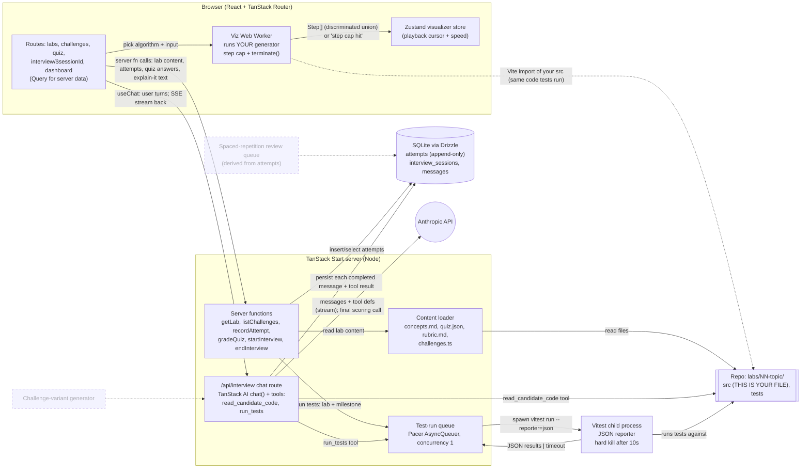
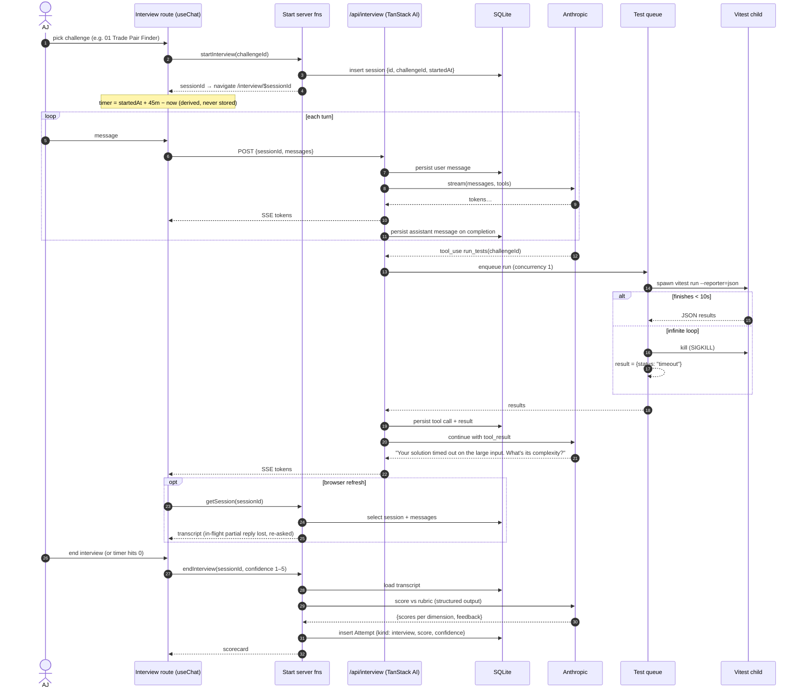

# DSA Playground — Build Plan

**Learning objective:** Get interview-ready on the core data structures and algorithm
patterns by building them yourself in TypeScript and applying them in original themed
challenges. That's the only learning goal. The app around the labs is a tool. Learning the
TanStack suite gets its own playground later.
**Stack:** React + TypeScript / TanStack Start (Node server functions) / SQLite + Drizzle,
Zustand, Tailwind CSS, Vitest, TanStack AI with the Anthropic adapter. Local only, single user.
**MVP:** A local app with a Big-O foundation and four themed labs (Arrays & Hashing, Two
Pointers / Sliding Window, Stack / Queue / Linked List, Trees / BST). In it you can run your
tests safely, step through your own algorithms, take quizzes, submit explain-it answers, and
sit a timed AI mock interview on one of the lab's challenges. Every attempt is recorded.

## What you'll have at the end
A repo where each lab is a themed TypeScript file with TODOs and failing tests that you turn
green, then a set of original themed challenges that make you apply what you built, each
solved with your own structure against local tests.
On top of it sits a small app that runs those tests in a process it can kill, plays
back your generator-based algorithms step by step, and quizzes you. It also runs a
45-minute mock interview that can read your code and run your tests, then scores you
against a rubric and adds the result to an attempt history that drives a mastery dashboard.

## Architecture decisions
- **Repo labs with failing tests, app as the shell around them** (AJ's call). You work in a
  real editor with git history; the app teaches, runs, and records.
- **DSA is the only learning goal** (AJ's call, revised). Lab and challenge milestones carry
  the concepts and checkpoints. App milestones have a "Done when" instead, and Claude
  writes app code by default. TanStack learning moves to a separate future playground.
- **Original themed challenges, no LeetCode** (AJ's call, revised). The point is to
  understand DSA and apply it project-style, not to grind a list. Each lab builds the data
  structure in a themed setting, then poses 4–8 challenges we wrote that must be solved by
  importing your own structure. Every challenge traces to a `concepts.md` §, like every
  other assessment.
- **Topic order: roadmap.sh DSA** (AJ's call). Challenges cover the standard pattern for
  each topic so interview skills still transfer. The full map is in `docs/curriculum.md`.
- **TanStack Start as the backend** (AJ's call). It holds the Anthropic key server-side.
  Phase 1 is already built on it, so it stays.
- **Libraries only when the app needs them** (revised). Start, Router, Query, AI and Pacer
  (the test queue) are in. TanStack DB, Form, Table, Virtual and Store are out: they were
  only here to be learned. Nothing alpha or deprecated.
- **Append-only attempts. Progress is always derived** (recommended, accepted). Test runs,
  quizzes, explain-its and interviews are all Attempt rows. Mastery and the retry list are
  queries over them, never stored.
- **The app runs Vitest on the server** (recommended, accepted). One runner path is shared
  by the Run Tests button and the interviewer's tool, so the app and the CLI never disagree.
- **Algorithms that can be visualized are generators that yield a typed `Step`
  discriminated union** (recommended, accepted). The plain answer is the generator run to
  completion, and the visualizer plays back your code, not a reference.
- **Same repo rules as System Design Playground** (recommended, accepted). `main` holds
  starters and failing tests, reference solutions live only on `solutions`, merges go
  one way, and Claude tutors and grades rather than solving.
- **SQLite + Drizzle** (taken on recommendation). It's one file, needs no container, and
  is enough for a single user.
- **Zustand owns client UI and playback state** (taken on recommendation). Server data goes
  through Query, and forms are plain React state.
- **Anthropic Claude as the interviewer** (AJ's call). Uses the TanStack AI Anthropic adapter.
- **Data structures are generic TypeScript classes behind interfaces** (AJ's call). That's
  the lab format, not a separate OOP curriculum. Functional programming is a separate
  project, and solutions don't have to be FP.

## System design
**Designed against:** your code is untrusted, including by you. An infinite loop triggered
by the Run Tests button, or by the interviewer's tool call 30 minutes into a 45-minute
interview, must not hang the server or kill the stream, and a browser refresh mid-interview
must not lose the transcript.
**Designed by:** Claude reference design, at AJ's request.

Container view: every process, store, and third party, with what crosses each arrow.
Dotted boxes are post-MVP.

Mock interview flow: start, streaming turns, a tool call that hits an infinite loop, a refresh, and scoring.

**The idea that organizes the design:** untrusted code only runs where it can be killed.
On the server that's a Vitest child process; in the browser it's a Web Worker. Everything
else (the queue, timeout-as-a-tool-result, per-message persistence) follows from that.

**Open questions:**
- Does TanStack AI 1.x support resuming a stream after refresh, or is regenerating the
  in-flight reply the best available behavior?
- Is a 10-second kill right? Your O(n²) answers on large inputs should fail as timeouts,
  but cold Vitest startup shouldn't.
- How does a Vite-imported lab file get into a Web Worker cleanly, and does hot reload
  pick up edits without restarting the worker?
- Can milestone filtering use Vitest's name filter on a `[1.2]` describe prefix, or does it
  need tags?
- What does a rubric need so that interview scores from the model are stable from one run
  to the next?

---

## Phase 1 — Walking skeleton: run untrusted code safely
**Goal:** One lab's tests can be run from the browser, an infinite loop can't hurt the
server, and the result is stored as an Attempt you can see.
**Builds:** UI → SF, SF → Q, Q → VT, VT → FS, SF → DB, and the Lab 01 starter in FS.

### Milestone 1.1 — Start app renders a lab page from the filesystem
Scaffold a TanStack Start app with Tailwind. Add a `/labs/$labId` route whose loader calls a
server function that reads `labs/01-pokedex-registry/README.md` and renders it. Create the
Lab 01 starter: a `HashMap<K, V>` class with TODOs and failing `[1.x]`-tagged tests.
- **Done when:** `/labs/01` renders the README on hard refresh and on client-side navigation.

### Milestone 1.2 — Run Tests button returns pass/fail per test
A server function spawns `vitest run` for one lab with the JSON reporter, parses the output,
and returns per-test results. Route it through a Pacer AsyncQueuer at concurrency 1.
- **Concept:** a FIFO queue in front of a shared, expensive resource. Phase 3 adds a second
  caller (the interviewer), and you don't want two Vitest runs fighting over RAM.
- **Checkpoint:** Break it deliberately. Click Run Tests five times fast. Predict the order
  and timing of results before you look, then check.

### Milestone 1.3 — An infinite loop becomes a timeout, not a hang
Put `while (true) {}` in your `HashMap.get`. The runner kills the child process after the
time limit and returns `{ status: "timeout" }`. The server stays responsive the whole time.
- **Done when:** the looping `get` returns a timeout result within the limit, and the page
  still responds while it runs.

### Milestone 1.4 — Each run is an Attempt row, listed on the lab page
Add SQLite + Drizzle with an append-only `attempts` table (kind, lab, milestone, score,
confidence, payload, createdAt). Record every run and list the history with TanStack Query.
- **Done when:** every run shows up in the lab page's history, and "which milestones have
  passed" is a query, not a column.

---

## Phase 2 — Labs 01–02 in the final format
**Goal:** Two full labs exist in the final lab format, with their challenges, and the app
lists every challenge in one place.
**Concept in focus:** hashing and amortized analysis, then two pointers, sliding windows and
the ring buffer that makes a deque O(1) at both ends.
**Builds:** CONTENT, the challenge tracker part of UI, and Labs 01–02 in FS.

### Milestone 2.1 — Lab 01 Pokédex Registry complete (Arrays & Hashing)
Finish the lab: `concepts.md` (§-sections on hashing, collisions, load factor, amortized
resize), a `HashMap<K, V>` with separate chaining that implements a `MapLike<K, V>`
interface and `[Symbol.iterator]`, plus the lab's challenges (duplicate detection,
anagram grouping, pair-sum, frequency top-k, consecutive runs), each solved with your
`HashMap`. Each challenge gets its own stub and local tests.
- **Concept:** an abstract data type vs its implementation. `MapLike` is the map ADT; your
  `HashMap` is one implementation of it, and the later lab's `TreeMap` is another, with
  different complexity guarantees and no shared code.
- **Checkpoint:** Break it deliberately. Make `hash()` return a constant. Predict which
  tests still pass and what happens to time complexity, then run the timing test.

### Milestone 2.2 — Lab 02 Combo Meter complete (Two Pointers / Sliding Window)
Build a generic `Deque<T>` on a ring buffer (resize, `#head`/`#tail`, iterator). Then the
challenges: palindrome check, sorted pair-sum, best buy/sell window, longest unique run,
and a sliding-window max over combo damage that uses your Deque.
- **Concept:** a ring buffer gives amortized O(1) at both ends, which an array with `shift`
  can't. The sliding-window max challenge shows the difference on large input.
- **Checkpoint:** Defend the choice. Explain why `Array.prototype.shift` makes the
  sliding-window max O(n·k) in the worst case, and when the naive version is actually fine.

### Milestone 2.3 — Challenge tracker: every challenge in one table
A `/challenges` route lists every challenge across labs, with columns for pattern,
difficulty, the `concepts.md` § it applies, and local status (derived from attempts).
Filters live in the URL search params so a filtered view can be bookmarked. A plain HTML
table is enough at this size.
- **Done when:** you can filter by pattern and difficulty, reload, and land on the same view.

---

## Phase 3 — Mock interviewer v1
**Goal:** A working mock interview where the model can see your code and run your tests,
and a timeout reaches it as information instead of an error.
**Builds:** CHAT, CHAT → ANT, CHAT → Q (the second caller on the queue), CHAT → FS.
Stresses Phase 1's queue design.

### Milestone 3.1 — Streaming interviewer chat on a chosen challenge
An `/interview/$sessionId` route with `useChat` and a server chat route using the
Anthropic adapter. The system prompt makes it act as an interviewer for one lab
challenge: clarifying questions first, never giving the answer, probing complexity and
edge cases.
- **Done when:** a reply streams in, the interviewer won't hand over the solution when
  asked, and the API key never appears in the browser.

### Milestone 3.2 — The interviewer reads your code and runs your tests
Add two tools: `read_candidate_code(challengeId)` and `run_tests(challengeId)`. `run_tests`
goes through the Phase 1 queue, not a new path.
- **Done when:** an infinite loop hit through `run_tests` mid-interview comes back to the
  model as a timeout, the model asks about complexity, and the stream survives.

### Milestone 3.3 — Interview timer and session record
Store `startedAt` on an interview session. The 45-minute timer is derived on the client
from `startedAt` and now, never counted down in state.
- **Done when:** the timer shows the right time remaining after a refresh.

---

## Phase 4 — Lab 03 and the step-through visualizer
**Goal:** You can step through your own Stack / Queue / Linked List algorithms, forward and
back, without the page ever freezing.
**Concept in focus:** stacks, queues and pointer manipulation in linked lists, and seeing
each algorithm's steps instead of just its output.
**Builds:** WK, WK → FS, WK → VZ, and Lab 03 in FS. Updates the container diagram if the
worker boundary changed from what's drawn.

### Milestone 4.1 — Lab 03 Quest Log complete (Stack / Queue / Linked List)
Build `Stack<T>`, a linked `Queue<T>`, `SinglyLinkedList<T>` and a doubly linked list for
LRU. Algorithms that can be visualized (reverse, cycle detection, merge) are generators
yielding `Step` unions. Challenges: bracket-balanced spell runes, a min-tracking
undo stack, a postfix damage calculator, next-warmer-day, reverse/merge quest chains,
cycle detection in a portal loop, and an LRU item cache.
- **Concept:** an operation is O(1) only if you already hold a pointer to where it
  happens. A tail pointer makes the queue's enqueue O(1), and a node map makes the LRU's
  move-to-front O(1).
- **Checkpoint:** Rebuild it. Implement the LRU cache challenge with no reference to your
  own lab code, then explain why both a hash map and a doubly linked list are required.

### Milestone 4.2 — Worker plays back your generator safely
A Web Worker imports your lab file, pulls steps up to a step cap, and posts them back. The
page can `terminate()` it. A generator that yields forever hits the cap, and one that never
yields gets terminated.
- **Done when:** a cycle-detection bug that loops forever ends in either "step cap hit" or
  a terminated worker, and the page never freezes.

### Milestone 4.3 — Playback controls
A Zustand store holds the steps, the cursor, play/pause and speed. Auto-play advances on
an interval. The renderer draws nodes and pointers for the current step.
- **Done when:** you can play, pause, step forward and step back through reverse, cycle
  detection and merge on your own code.

---

## Phase 5 — Assessments that compound
**Goal:** Quizzes, explain-it grading and interview scoring all feed one attempt history,
the dashboard derives mastery from it, and the MVP's last lab is done.
**Concept in focus:** trees and BSTs, plus complexity reasoning you have to explain out loud.
**Builds:** interview resume and scoring (CHAT → DB, SF → ANT), and Lab 04 in FS.

### Milestone 5.1 — Quizzes and explain-it grading
Lab 00 (Big-O Speedrun Splits) is quiz-only. Every lab gets a `quiz.json`: complexity,
which pattern fits, predict the output. Explain-it answers (approach plus Big-O, with
confidence 1–5) are graded against the lab's `rubric.md` by a structured-output call.
- **Done when:** a quiz and an explain-it for Lab 01 each record an Attempt with score and
  confidence, and every question traces to a `concepts.md` §.

### Milestone 5.2 — Interviews resume after refresh and end with a scorecard
Persist each completed message and tool result. On load, rebuild the transcript from
SQLite. `endInterview` asks for your confidence, scores the transcript against the
interview rubric, and records an Attempt.
- **Done when:** refreshing mid-interview restores every completed message, and ending
  the interview records a scorecard Attempt.

### Milestone 5.3 — Lab 04 Skill Tree and the mastery dashboard
Build `BinaryTree<T>` and `BST<T>` with an injected comparator, with traversals as
generators (and therefore visualizable). `TreeMap` implements Phase 2's `MapLike`.
Challenges: mirror a skill tree, max depth and diameter, balance check, same-tree and
subtree match, level-order unlock tiers, validate a BST, k-th cheapest skill, and
serialize/deserialize a build.
The dashboard derives per-pattern mastery, calibration gap (confidence vs score), and what
to retry, all from attempts.
- **Concept:** a BST's operations are O(height), and height depends on insertion order.
  `TreeMap` and `HashMap` satisfy the same `MapLike` ADT with different guarantees.
- **Checkpoint:** Break it deliberately. Insert skills into your BST in sorted cost order.
  Predict the tree's height and the cost of "k-th cheapest skill", then check by timing it.

---

## MVP is done when
- Every lab's tests, and its challenges' local tests, can be run from the app.
  An infinite loop in any of them returns a timeout and leaves the server responsive.
- At least one algorithm per lab plays back step by step from your own code.
- Every lab has a quiz and an explain-it rubric, and both record attempts.
- You can finish a 45-minute mock interview on any challenge, survive a refresh, and
  get a recorded scorecard.
- The dashboard shows per-pattern mastery and calibration gap, derived from attempts only.

## Deliberately not in the MVP
- Labs past Trees / BST (Binary Search, Tries, Heaps, Graphs, DP and the rest), listed in
  `docs/curriculum.md`.
- Challenge-variant generator and spaced-repetition review queue (the dotted boxes).
- In-browser code editor for drills.
- Resumable streaming of an in-flight interview reply.
- Auth, multiple users, deployment.
- Learning the TanStack suite (DB, Form, Table, Virtual, Store and the rest), which gets
  its own playground later.
- Functional programming, which gets its own project.
