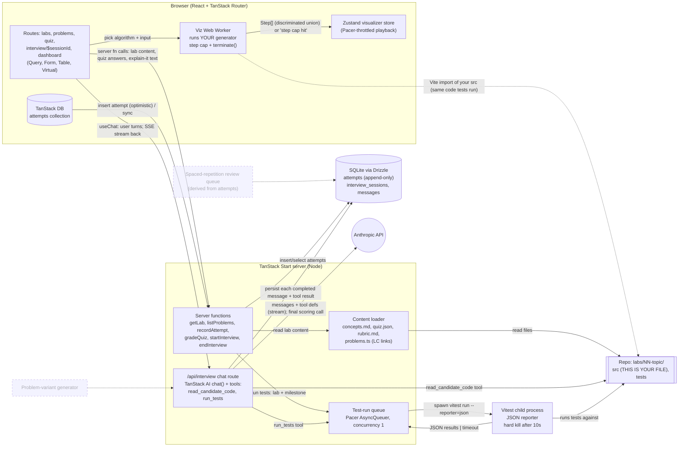
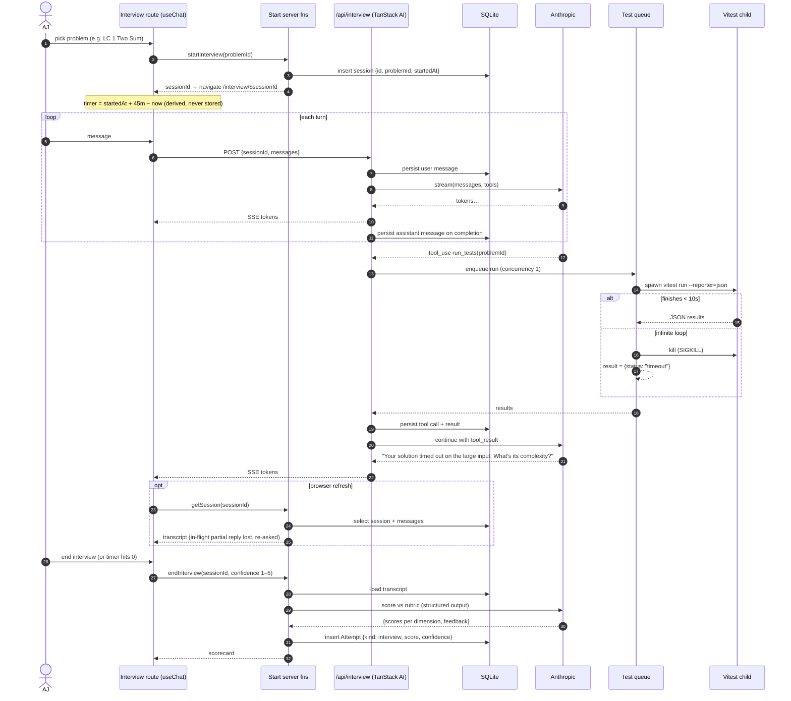

# DSA Playground — Build Plan

**Learning objective:** Get interview-ready on the core data structures and algorithm
patterns by building them yourself in TypeScript, and learn the stable TanStack suite
(Start, Router, Query, Form, Table, Virtual, AI, DB, Store, Pacer) plus TypeScript OOP by
building the platform that teaches, tests, and interviews you.
**Stack:** React + TypeScript / TanStack Start (Node server functions) / SQLite + Drizzle,
Zustand, Tailwind CSS, Vitest, TanStack AI with the Anthropic adapter. Local only, single user.
**MVP:** A local app with a Big-O foundation and four themed labs (Arrays & Hashing, Two
Pointers / Sliding Window, Stack / Queue / Linked List, Trees / BST). In it you can run your
tests safely, step through your own algorithms, take quizzes, submit explain-it answers, and
sit a timed AI mock interview on a linked LeetCode problem. Every attempt is recorded.

## What you'll have at the end
A repo where each lab is a themed TypeScript file with TODOs and failing tests that you turn
green, plus a set of real LeetCode problems (linked, not copied) solved against local tests.
On top of it sits a TanStack Start app that runs those tests in a process it can kill, plays
back your generator-based algorithms step by step, and quizzes you. It also runs a
45-minute mock interview that can read your code and run your tests, then scores you
against a rubric and adds the result to an attempt history that drives a mastery dashboard.

## Architecture decisions
- **Repo labs with failing tests, app as the shell around them** (AJ's call). You work in a
  real editor with git history; the app teaches, runs, and records.
- **Real LeetCode problems, themed labs** (AJ's call). Each lab builds the data structure
  in a themed setting, then links real LeetCode problems by number and slug. Problem
  statements and LC test data are never copied in. Local tests are our own.
- **Topic order: roadmap.sh DSA for concepts, NeetCode 150 buckets for problems** (AJ's call).
  This is the de facto interview-prep standard. The full map is in `docs/curriculum.md`.
- **TanStack Start as the backend** (AJ's call). It holds the Anthropic key server-side,
  and every server feature becomes a chance to learn Start.
- **Every stable TanStack library, nothing alpha or deprecated** (AJ's call). Checked on
  npm at planning time: Start, Router, Query, Form, Table, Virtual and AI are 1.x or later.
  DB is a 1.0 release candidate. Store and Pacer are pre-1.0 but past alpha. Devtools,
  Hotkeys, Ranger and the Form 2 / Table 10 alphas are out.
- **Append-only attempts. Progress is always derived** (recommended, accepted). Test runs,
  quizzes, explain-its and interviews are all Attempt rows. Mastery and the retry list are
  queries over them, never stored.
- **The app runs Vitest on the server** (recommended, accepted). One runner path is shared
  by the Run Tests button and the interviewer's tool, so the app and the CLI never disagree.
- **Algorithms that can be visualized are generators that yield a typed `Step`
  discriminated union** (recommended, accepted). The plain answer is the generator run to
  completion, and the visualizer plays back your code, not a reference.
- **Same repo rules as System Design Playground** (recommended, accepted). `main` holds
  starters and failing tests, reference solutions live only on `solutions`, merges go
  one way, and Claude tutors and grades rather than solving.
- **SQLite + Drizzle** (taken on recommendation). It's one file, needs no container, and
  is enough for a single user.
- **Zustand owns client UI and playback state. TanStack Store appears through Form plus one
  deliberate comparison milestone** (taken on recommendation). You asked for both; this
  gives each a job instead of having them duplicate each other.
- **Anthropic Claude as the interviewer** (AJ's call). Uses the TanStack AI Anthropic adapter.
- **TypeScript OOP is in scope. Functional programming is a separate project** (AJ's call).
  Data structures are generic classes behind interfaces. Solutions don't have to be FP.

## System design
**Designed against:** your code is untrusted, including by you. An infinite loop triggered
by the Run Tests button, or by the interviewer's tool call 30 minutes into a 45-minute
interview, must not hang the server or kill the stream, and a browser refresh mid-interview
must not lose the transcript.
**Designed by:** Claude reference design, at AJ's request.

Container view: every process, store, and third party, with what crosses each arrow.
Dotted boxes are post-MVP.

Mock interview flow: start, streaming turns, a tool call that hits an infinite loop, a refresh, and scoring.

**The idea that organizes the design:** untrusted code only runs where it can be killed.
On the server that's a Vitest child process; in the browser it's a Web Worker. Everything
else (the queue, timeout-as-a-tool-result, per-message persistence) follows from that.

**Open questions:**
- Does TanStack AI 1.x support resuming a stream after refresh, or is regenerating the
  in-flight reply the best available behavior?
- Is a 10-second kill right? Your O(n²) answers on large inputs should fail as timeouts,
  but cold Vitest startup shouldn't.
- How does a Vite-imported lab file get into a Web Worker cleanly, and does hot reload
  pick up edits without restarting the worker?
- Can milestone filtering use Vitest's name filter on a `[1.2]` describe prefix, or does it
  need tags?
- What does a rubric need so that interview scores from the model are stable from one run
  to the next?

---

## Phase 1 — Walking skeleton: run untrusted code safely
**Goal:** One lab's tests can be run from the browser, an infinite loop can't hurt the
server, and the result is stored as an Attempt you can see.
**Concept in focus:** TanStack Start server functions and process isolation. Code you
didn't fully trust runs in a process you can kill.
**Builds:** UI → SF, SF → Q, Q → VT, VT → FS, SF → DB, and the Lab 01 starter in FS.

### Milestone 1.1 — Start app renders a lab page from the filesystem
Scaffold a TanStack Start app with Tailwind. Add a `/labs/$labId` route whose loader calls a
server function that reads `labs/01-pokedex-registry/README.md` and renders it. Create the
Lab 01 starter: a `HashMap<K, V>` class with TODOs and failing `[1.x]`-tagged tests.
- **Concept:** server functions vs route loaders: the loader decides *when* data is
  fetched, and the server function decides *where* it runs. That split appears on every
  route you build after this.
- **Checkpoint:** Explain it cold. Describe what runs on the server and what runs in the
  browser when you hard-refresh `/labs/01`, and when you navigate there client-side.
  Then verify with the network tab.

### Milestone 1.2 — Run Tests button returns pass/fail per test
A server function spawns `vitest run` for one lab with the JSON reporter, parses the output,
and returns per-test results. Route it through a Pacer AsyncQueuer at concurrency 1.
- **Concept:** a single queue for a shared, expensive resource. Phase 3 adds a second caller
  (the interviewer), and you don't want two Vitest runs fighting over RAM.
- **Checkpoint:** Break it deliberately. Click Run Tests five times fast. Predict the order
  and timing of results before you look, then check.

### Milestone 1.3 — An infinite loop becomes a timeout, not a hang
Put `while (true) {}` in your `HashMap.get`. The runner kills the child process after the
time limit and returns `{ status: "timeout" }`. The server stays responsive the whole time.
- **Concept:** why Vitest's `testTimeout` can't save you from a synchronous infinite loop
  when an external kill can. This is the constraint the whole design rests on.
- **Checkpoint:** Defend the choice. In three sentences: why a child process instead of
  `worker_threads` in the server process, and what would change your mind.

### Milestone 1.4 — Each run is an Attempt row, listed on the lab page
Add SQLite + Drizzle with an append-only `attempts` table (kind, lab, milestone, score,
confidence, payload, createdAt). Record every run and list the history with TanStack Query.
- **Concept:** append-only facts vs mutable status. "Has milestone 1.2 passed?" becomes a
  query, never a column.
- **Checkpoint:** Explain it cold. Write the query that answers "which milestones have I
  passed at least once, and which did I pass and then break?" without adding a column.

---

## Phase 2 — Lab format and TypeScript OOP data structures
**Goal:** Two full labs exist in the final lab format, built as idiomatic OOP TypeScript,
and the app has a real problem tracker.
**Concept in focus:** TypeScript OOP (generics, interfaces, `#private` fields, iterators,
abstract bases) and server-state caching with Router + Query.
**Builds:** CONTENT, the problem tracker part of UI (Table + Virtual), and Labs 01–02 in FS.

### Milestone 2.1 — Lab 01 Pokédex Registry complete (Arrays & Hashing)
Finish the lab: `concepts.md` (§-sections on hashing, collisions, load factor, amortized
resize), a `HashMap<K, V>` with separate chaining that implements a `MapLike<K, V>`
interface and `[Symbol.iterator]`, plus linked LeetCode problems (217, 242, 1, 49, 347,
238, 36, 128). Each problem gets its own stub and local tests.
- **Concept:** interface vs class vs abstract class. `MapLike` is an interface because the
  later lab's `TreeMap` also implements it and shares no code with `HashMap`.
- **Checkpoint:** Break it deliberately. Make `hash()` return a constant. Predict which
  tests still pass and what happens to time complexity, then run the timing test.

### Milestone 2.2 — Lab 02 Combo Meter complete (Two Pointers / Sliding Window)
Build a generic `Deque<T>` on a ring buffer (resize, `#head`/`#tail`, iterator). Link
problems 125, 167, 15, 11, 42, 121, 3, 424, 567, 76, 239. Problem 239 uses your Deque.
- **Concept:** a ring buffer gives amortized O(1) at both ends, which an array with `shift`
  can't. Problem 239 shows the difference on large input.
- **Checkpoint:** Defend the choice. Explain why `Array.prototype.shift` makes 239
  O(n·k) in the worst case, and when the naive version is actually fine.

### Milestone 2.3 — Problem tracker: every linked problem in one table
A `/problems` route lists every linked LC problem across labs, with columns for pattern,
difficulty, local status (derived from attempts) and an LC link. Use TanStack Table for
sort/filter, TanStack Virtual for rows, and search params in the URL with Router's typed
`validateSearch`.
- **Concept:** filters in the URL vs in component state. A filtered view you can bookmark
  is server-state-friendly, and Query's cache key follows from it for free.
- **Checkpoint:** Explain it cold. Trace what happens in Router, Query and Table when you
  change the difficulty filter, and say which step triggers a network request and why.

---

## Phase 3 — Mock interviewer v1 (TanStack AI)
**Goal:** A working mock interview where the model can see your code and run your tests,
and a timeout reaches it as information instead of an error.
**Concept in focus:** TanStack AI: streaming chat, tool definitions, and the tool-call loop.
**Builds:** CHAT, CHAT → ANT, CHAT → Q (the second caller on the queue), CHAT → FS.
Stresses Phase 1's queue design.

### Milestone 3.1 — Streaming interviewer chat on a chosen problem
An `/interview/$sessionId` route with `useChat` and a server chat route using the
Anthropic adapter. The system prompt makes it act as an interviewer for one LeetCode
problem: clarifying questions first, never giving the answer, probing complexity.
- **Concept:** streaming responses (SSE) vs request/response, and why the API key never
  reaches the browser.
- **Checkpoint:** Explain it cold. Describe what crosses the wire between the browser and
  the chat route during one assistant reply, then confirm it in the network tab.

### Milestone 3.2 — The interviewer reads your code and runs your tests
Add two tools: `read_candidate_code(problemId)` and `run_tests(problemId)`. `run_tests`
goes through the Phase 1 queue, not a new path.
- **Concept:** tools are typed contracts the model chooses to call. Your server executes
  them and the model only sees the result.
- **Checkpoint:** Break it deliberately. Make `run_tests` hit an infinite loop mid-interview.
  Predict what the model says next before you look, then check that the stream survived.

### Milestone 3.3 — Interview timer and session record
Store `startedAt` on an interview session. The 45-minute timer is derived on the client
from `startedAt` and now, never counted down in state.
- **Concept:** derived state again, this time across a page refresh. A stored countdown
  drifts and a derived one can't.
- **Checkpoint:** Defend the choice. Explain why the timer survives a refresh and would
  still survive one if it lived in Zustand, and name the one thing that would break it.

---

## Phase 4 — Visualizer: generators, Zustand, Pacer
**Goal:** You can step through your own Stack / Queue / Linked List algorithms, forward and
back, without the page ever freezing.
**Concept in focus:** generators as a step protocol, and client state with Zustand.
**Builds:** WK, WK → FS, WK → VZ, and Lab 03 in FS. Updates the container diagram if the
worker boundary changed from what's drawn.

### Milestone 4.1 — Lab 03 Quest Log complete (Stack / Queue / Linked List)
Build `Stack<T>`, a linked `Queue<T>`, `SinglyLinkedList<T>` and a doubly linked list for
LRU. Algorithms that can be visualized (reverse, cycle detection, merge) are generators
yielding `Step` unions. Link problems 20, 155, 150, 739, 84, 206, 21, 143, 19, 141, 287,
146 and 23.
- **Concept:** a `Step` discriminated union with exhaustive `switch` narrowing. Adding a
  new step type becomes a compile error everywhere it isn't handled.
- **Checkpoint:** Rebuild it. Implement LRU (146) with no reference to your own lab code,
  then explain why both a hash map and a doubly linked list are required.

### Milestone 4.2 — Worker plays back your generator safely
A Web Worker imports your lab file, pulls steps up to a step cap, and posts them back. The
page can `terminate()` it. A generator that yields forever hits the cap, and one that never
yields gets terminated.
- **Concept:** the same isolation rule as Phase 1, applied in the browser.
- **Checkpoint:** Break it deliberately. Write a cycle-detection bug that loops forever.
  Predict which guard catches it, the step cap or terminate, and why, then check.

### Milestone 4.3 — Playback controls with Zustand and Pacer
A Zustand store holds the steps, the cursor, play/pause and speed. Pacer throttles
auto-play. The renderer draws nodes and pointers for the current step.
- **Concept:** where state belongs: steps and cursor are client state (Zustand), and none
  of this belongs in Query.
- **Checkpoint:** Explain it cold. Why doesn't stepping backward re-run the generator, and
  what would you have to change if it did?

### Milestone 4.4 — Same store in TanStack Store, then pick one
Reimplement the playback store in TanStack Store on a branch and compare the
subscriptions, selectors, and derived values. Keep one in `main`.
- **Concept:** two stores with the same job. Seeing the differences tells you which
  problem each one was built for.
- **Checkpoint:** Defend the choice. Write a short paragraph on which one you kept, and
  what feature would make you switch.

---

## Phase 5 — Assessments that compound
**Goal:** Quizzes, explain-it grading and interview scoring all feed one attempt history,
the dashboard derives mastery from it, and the MVP's last lab is done.
**Concept in focus:** TanStack DB collections and TanStack Form, built on the append-only
model. This phase deliberately rewrites Phase 1's plain Query fetching of attempts.
**Builds:** ADB, ADB → SF, interview resume and scoring (CHAT → DB, SF → ANT), and Lab 04 in
FS. Update the container diagram to show attempts flowing through TanStack DB.

### Milestone 5.1 — Attempts move into a TanStack DB collection
Replace the per-route attempt queries with one attempts collection and live queries. New
attempts show up optimistically everywhere they're displayed.
- **Concept:** a client-side collection with live queries vs scattered Query caches. You
  just felt the invalidation pain this removes.
- **Checkpoint:** Break it deliberately. Make the insert fail on the server. Predict what
  the UI shows before and after the rollback, then check.

### Milestone 5.2 — Quizzes and explain-it with TanStack Form
Lab 00 (Big-O Speedrun Splits) is quiz-only. Every lab gets a `quiz.json`: complexity,
which pattern fits, predict the output. Explain-it answers (approach plus Big-O, with
confidence 1–5) are graded against the lab's `rubric.md` by a structured-output call.
- **Concept:** form state lives in TanStack Form, and through it TanStack Store, while
  validation is shared with the server.
- **Checkpoint:** Explain it cold. Say where each field's value, its validation error and
  its submitting state live, and which part of the Form API owns each.

### Milestone 5.3 — Interviews resume after refresh and end with a scorecard
Persist each completed message and tool result. On load, rebuild the transcript from
SQLite. `endInterview` asks for your confidence, scores the transcript against the
interview rubric, and records an Attempt.
- **Concept:** persist at the smallest unit you can't afford to lose. A completed message
  is that unit, and a half-streamed reply isn't worth keeping.
- **Checkpoint:** Break it deliberately. Refresh mid-reply and mid-tool-call. Predict what
  each one restores, then check against the sequence diagram.

### Milestone 5.4 — Lab 04 Skill Tree and the mastery dashboard
Build `BinaryTree<T>` and `BST<T>` with an injected comparator, with traversals as
generators (and therefore visualizable). `TreeMap` implements Phase 2's `MapLike`. Link
problems 226, 104, 543, 110, 100, 572, 235, 102, 199, 1448, 98, 230, 105, 124 and 297.
The dashboard derives per-pattern mastery, calibration gap (confidence vs score), and what
to retry, all from attempts.
- **Concept:** the payoff of append-only. New views are new queries, not migrations.
- **Checkpoint:** Redraw it cold. Reproduce the container diagram in Mermaid from memory
  and diff it against this file. Every box you forgot is one you don't understand yet.

---

## MVP is done when
- Every lab's tests, and its linked LeetCode problems' local tests, can be run from the app.
  An infinite loop in any of them returns a timeout and leaves the server responsive.
- At least one algorithm per lab plays back step by step from your own code.
- Every lab has a quiz and an explain-it rubric, and both record attempts.
- You can finish a 45-minute mock interview on any linked problem, survive a refresh, and
  get a recorded scorecard.
- The dashboard shows per-pattern mastery and calibration gap, derived from attempts only.

## Deliberately not in the MVP
- Labs past Trees / BST (Binary Search, Tries, Heaps, Graphs, DP and the rest), listed in
  `docs/curriculum.md`.
- Problem-variant generator and spaced-repetition review queue (the dotted boxes).
- In-browser code editor for drills.
- Resumable streaming of an in-flight interview reply.
- Auth, multiple users, deployment.
- Functional programming, which gets its own project.
