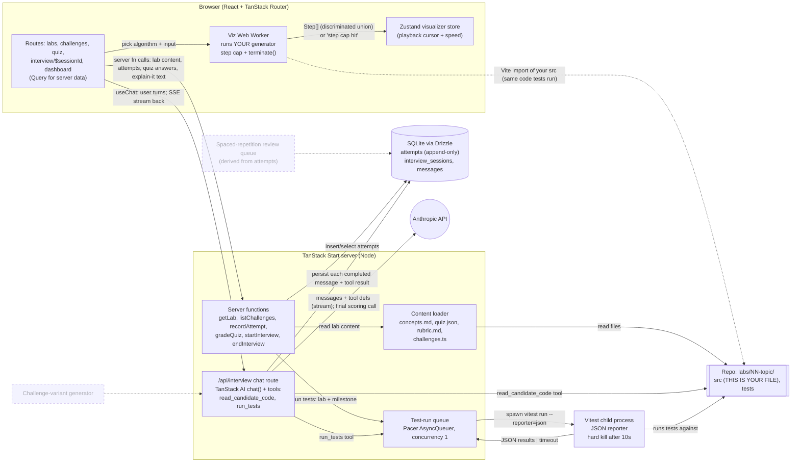
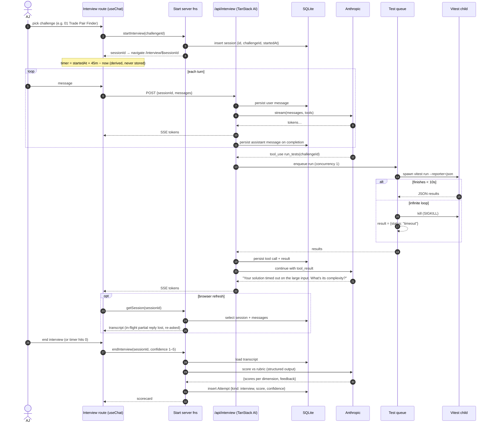

# DSA Playground — Build Plan

**Learning objective:** Get interview-ready on the core data structures and algorithm
patterns by building them yourself in TypeScript and applying them in original themed
challenges. That's the only learning goal. The app around the labs is a tool. Learning the
TanStack suite gets its own playground later.
**Stack:** React + TypeScript / TanStack Start (Node server functions) / SQLite + Drizzle,
Zustand, Tailwind CSS, Vitest, TanStack AI with the Anthropic adapter. Local only, single user.
**MVP:** A local app and the full curriculum: 31 Pokémon-themed labs (00–30) covering every
in-scope topic of the roadmap.sh Computer Science roadmap plus the standard interview
patterns. Phases 1–5 build the app alongside Labs 00–04. Phases 6–9 are lab-only and cover
Labs 05–30. In the app you can run your tests safely, step through your own algorithms,
take quizzes, submit explain-it answers, and sit a timed AI mock interview on any lab's
challenges. Every attempt is recorded.

## What you'll have at the end
A repo where each lab is a themed TypeScript file with TODOs and failing tests that you turn
green, then a set of original themed challenges that make you apply what you built, each
solved with your own structure against local tests.
On top of it sits a small app that runs those tests in a process it can kill, plays
back your generator-based algorithms step by step, and quizzes you. It also runs a
45-minute mock interview that can read your code and run your tests, then scores you
against a rubric and adds the result to an attempt history that drives a mastery dashboard.

## Architecture decisions
- **Repo labs with failing tests, app as the shell around them** (AJ's call). You work in a
  real editor with git history; the app teaches, runs, and records.
- **DSA is the only learning goal** (AJ's call, revised). Lab and challenge milestones carry
  the concepts and checkpoints. App milestones have a "Done when" instead, and Claude
  writes app code by default. TanStack learning moves to a separate future playground.
- **Original themed challenges, no LeetCode** (AJ's call, revised). The point is to
  understand DSA and apply it project-style, not to grind a list. Each lab builds the data
  structure in a themed setting, then poses 4–8 challenges we wrote that must be solved by
  importing your own structure. Every challenge traces to a `concepts.md` §, like every
  other assessment.
- **Topic coverage: the roadmap.sh Computer Science roadmap, all of it in the MVP** (AJ's
  call, revised). Out of scope: Pick a Language, Design Patterns, UML, System Design,
  Databases, Security, Networking, How Computers Work, Processes and Threads, Endianness,
  Floating Point and Character Encodings. Challenges cover the standard pattern for each
  topic so interview skills still transfer. The full map and a node-by-node coverage table
  are in `docs/curriculum.md`.
- **Every lab is Pokémon themed** (AJ's call). The canonical topic name stays next to the
  themed one.
- **Lab numbers are the build order** (Claude's call). A lab only uses structures from
  lower-numbered labs: heap before heap sort, Dijkstra, Prim's and Huffman; union-find
  before Kruskal's; B-tree before red-black.
- **TanStack Start as the backend** (AJ's call). It holds the Anthropic key server-side.
  Phase 1 is already built on it, so it stays.
- **Libraries only when the app needs them** (revised). Start, Router, Query, AI and Pacer
  (the test queue) are in. TanStack DB, Form, Table, Virtual and Store are out: they were
  only here to be learned. Nothing alpha or deprecated.
- **Append-only attempts. Progress is always derived** (recommended, accepted). Test runs,
  quizzes, explain-its and interviews are all Attempt rows. Mastery and the retry list are
  queries over them, never stored.
- **The app runs Vitest on the server** (recommended, accepted). One runner path is shared
  by the Run Tests button and the interviewer's tool, so the app and the CLI never disagree.
- **Algorithms that can be visualized are generators that yield a typed `Step`
  discriminated union** (recommended, accepted). The plain answer is the generator run to
  completion, and the visualizer plays back your code, not a reference.
- **Same repo rules as System Design Playground** (recommended, accepted). `main` holds
  starters and failing tests, reference solutions live only on `solutions`, merges go
  one way, and Claude tutors and grades rather than solving.
- **SQLite + Drizzle** (taken on recommendation). It's one file, needs no container, and
  is enough for a single user.
- **Zustand owns client UI and playback state** (taken on recommendation). Server data goes
  through Query, and forms are plain React state.
- **Anthropic Claude as the interviewer** (AJ's call). Uses the TanStack AI Anthropic adapter.
- **Data structures are generic TypeScript classes behind interfaces** (AJ's call). That's
  the lab format, not a separate OOP curriculum. Functional programming is a separate
  project, and solutions don't have to be FP.

## System design
**Designed against:** your code is untrusted, including by you. An infinite loop triggered
by the Run Tests button, or by the interviewer's tool call 30 minutes into a 45-minute
interview, must not hang the server or kill the stream, and a browser refresh mid-interview
must not lose the transcript.
**Designed by:** Claude reference design, at AJ's request.

Container view: every process, store, and third party, with what crosses each arrow.
Dotted boxes are post-MVP.

Mock interview flow: start, streaming turns, a tool call that hits an infinite loop, a refresh, and scoring.

**The idea that organizes the design:** untrusted code only runs where it can be killed.
On the server that's a Vitest child process; in the browser it's a Web Worker. Everything
else (the queue, timeout-as-a-tool-result, per-message persistence) follows from that.

**Open questions:**
- Does TanStack AI 1.x support resuming a stream after refresh, or is regenerating the
  in-flight reply the best available behavior?
- Is a 10-second kill right? Your O(n²) answers on large inputs should fail as timeouts,
  but cold Vitest startup shouldn't.
- How does a Vite-imported lab file get into a Web Worker cleanly, and does hot reload
  pick up edits without restarting the worker?
- Can milestone filtering use Vitest's name filter on a `[1.2]` describe prefix, or does it
  need tags?
- What does a rubric need so that interview scores from the model are stable from one run
  to the next?

---

## Phase 1 — Walking skeleton: run untrusted code safely
**Goal:** One lab's tests can be run from the browser, an infinite loop can't hurt the
server, and the result is stored as an Attempt you can see.
**Builds:** UI → SF, SF → Q, Q → VT, VT → FS, SF → DB, and the Lab 01 starter in FS.

### Milestone 1.1 — Start app renders a lab page from the filesystem
Scaffold a TanStack Start app with Tailwind. Add a `/labs/$labId` route whose loader calls a
server function that reads `labs/01-pokedex-registry/README.md` and renders it. Create the
Lab 01 starter: a `HashMap<K, V>` class with TODOs and failing `[1.x]`-tagged tests.
- **Done when:** `/labs/01` renders the README on hard refresh and on client-side navigation.

### Milestone 1.2 — Run Tests button returns pass/fail per test
A server function spawns `vitest run` for one lab with the JSON reporter, parses the output,
and returns per-test results. Route it through a Pacer AsyncQueuer at concurrency 1.
- **Concept:** a FIFO queue in front of a shared, expensive resource. Phase 3 adds a second
  caller (the interviewer), and you don't want two Vitest runs fighting over RAM.
- **Checkpoint:** Break it deliberately. Click Run Tests five times fast. Predict the order
  and timing of results before you look, then check.

### Milestone 1.3 — An infinite loop becomes a timeout, not a hang
Put `while (true) {}` in your `HashMap.get`. The runner kills the child process after the
time limit and returns `{ status: "timeout" }`. The server stays responsive the whole time.
- **Done when:** the looping `get` returns a timeout result within the limit, and the page
  still responds while it runs.

### Milestone 1.4 — Each run is an Attempt row, listed on the lab page
Add SQLite + Drizzle with an append-only `attempts` table (kind, lab, milestone, score,
confidence, payload, createdAt). Record every run and list the history with TanStack Query.
- **Done when:** every run shows up in the lab page's history, and "which milestones have
  passed" is a query, not a column.

---

## Phase 2 — Labs 01–02 in the final format
**Goal:** Two full labs exist in the final lab format, with their challenges, and the app
lists every challenge in one place.
**Concept in focus:** hashing and amortized analysis, then two pointers, sliding windows and
the ring buffer that makes a deque O(1) at both ends.
**Builds:** CONTENT, the challenge tracker part of UI, and Labs 01–02 in FS.

### Milestone 2.1 — Lab 01 Pokédex Registry complete (Arrays & Hashing)
Finish the lab: `concepts.md` (§-sections on hashing, collisions, load factor, amortized
resize), a `HashMap<K, V>` with separate chaining that implements a `MapLike<K, V>`
interface and `[Symbol.iterator]`, plus the lab's challenges (duplicate detection,
anagram grouping, pair-sum, frequency top-k, consecutive runs), each solved with your
`HashMap`. Each challenge gets its own stub and local tests.
- **Concept:** an abstract data type vs its implementation. `MapLike` is the map ADT; your
  `HashMap` is one implementation of it, and the later lab's `TreeMap` is another, with
  different complexity guarantees and no shared code.
- **Checkpoint:** Break it deliberately. Make `hash()` return a constant. Predict which
  tests still pass and what happens to time complexity, then run the timing test.

### Milestone 2.2 — Lab 02 Fury Cutter Chain complete (Two Pointers / Sliding Window)
Build a generic `Deque<T>` on a ring buffer (resize, `#head`/`#tail`, iterator). Then the
challenges: palindrome nickname check, sorted pair-sum, best buy/sell window at the Poké
Mart, longest unique run, and a sliding-window max over Fury Cutter chain damage that uses
your Deque.
- **Concept:** a ring buffer gives amortized O(1) at both ends, which an array with `shift`
  can't. The sliding-window max challenge shows the difference on large input.
- **Checkpoint:** Defend the choice. Explain why `Array.prototype.shift` makes the
  sliding-window max O(n·k) in the worst case, and when the naive version is actually fine.

### Milestone 2.3 — Challenge tracker: every challenge in one table
A `/challenges` route lists every challenge across labs, with columns for pattern,
difficulty, the `concepts.md` § it applies, and local status (derived from attempts).
Filters live in the URL search params so a filtered view can be bookmarked. A plain HTML
table is enough at this size.
- **Done when:** you can filter by pattern and difficulty, reload, and land on the same view.

---

## Phase 3 — Mock interviewer v1
**Goal:** A working mock interview where the model can see your code and run your tests,
and a timeout reaches it as information instead of an error.
**Builds:** CHAT, CHAT → ANT, CHAT → Q (the second caller on the queue), CHAT → FS.
Stresses Phase 1's queue design.

### Milestone 3.1 — Streaming interviewer chat on a chosen challenge
An `/interview/$sessionId` route with `useChat` and a server chat route using the
Anthropic adapter. The system prompt makes it act as an interviewer for one lab
challenge: clarifying questions first, never giving the answer, probing complexity and
edge cases.
- **Done when:** a reply streams in, the interviewer won't hand over the solution when
  asked, and the API key never appears in the browser.

### Milestone 3.2 — The interviewer reads your code and runs your tests
Add two tools: `read_candidate_code(challengeId)` and `run_tests(challengeId)`. `run_tests`
goes through the Phase 1 queue, not a new path.
- **Done when:** an infinite loop hit through `run_tests` mid-interview comes back to the
  model as a timeout, the model asks about complexity, and the stream survives.

### Milestone 3.3 — Interview timer and session record
Store `startedAt` on an interview session. The 45-minute timer is derived on the client
from `startedAt` and now, never counted down in state.
- **Done when:** the timer shows the right time remaining after a refresh.

---

## Phase 4 — Lab 03 and the step-through visualizer
**Goal:** You can step through your own Stack / Queue / Linked List algorithms, forward and
back, without the page ever freezing.
**Concept in focus:** stacks, queues and pointer manipulation in linked lists, and seeing
each algorithm's steps instead of just its output.
**Builds:** WK, WK → FS, WK → VZ, and Lab 03 in FS. Updates the container diagram if the
worker boundary changed from what's drawn.

### Milestone 4.1 — Lab 03 Bill's PC complete (Stack / Queue / Linked List)
Build `Stack<T>`, a linked `Queue<T>`, `SinglyLinkedList<T>` and a doubly linked list for
LRU. Algorithms that can be visualized (reverse, cycle detection, merge) are generators
yielding `Step` unions. Challenges: bracket-balanced Unown inscriptions, a min-tracking
undo stack for box moves, a postfix damage calculator, next-stronger-opponent,
reverse/merge evolution chains, cycle detection in a warp-tile loop, and an LRU cache of
recently opened boxes.
- **Concept:** an operation is O(1) only if you already hold a pointer to where it
  happens. A tail pointer makes the queue's enqueue O(1), and a node map makes the LRU's
  move-to-front O(1).
- **Checkpoint:** Rebuild it. Implement the LRU cache challenge with no reference to your
  own lab code, then explain why both a hash map and a doubly linked list are required.

### Milestone 4.2 — Worker plays back your generator safely
A Web Worker imports your lab file, pulls steps up to a step cap, and posts them back. The
page can `terminate()` it. A generator that yields forever hits the cap, and one that never
yields gets terminated.
- **Done when:** a cycle-detection bug that loops forever ends in either "step cap hit" or
  a terminated worker, and the page never freezes.

### Milestone 4.3 — Playback controls
A Zustand store holds the steps, the cursor, play/pause and speed. Auto-play advances on
an interval. The renderer draws nodes and pointers for the current step.
- **Done when:** you can play, pause, step forward and step back through reverse, cycle
  detection and merge on your own code.

---

## Phase 5 — Assessments that compound
**Goal:** Quizzes, explain-it grading and interview scoring all feed one attempt history,
the dashboard derives mastery from it, and the last lab built alongside the app is done.
**Concept in focus:** trees and BSTs, plus complexity reasoning you have to explain out loud.
**Builds:** interview resume and scoring (CHAT → DB, SF → ANT), and Lab 04 in FS.

### Milestone 5.1 — Quizzes and explain-it grading
Lab 00 (Speed Stat Check — Asymptotic Notation) is quiz-only. Its `concepts.md` covers
Big-O, Big-Theta and Big-Omega, the common runtimes ladder (constant, logarithmic, linear,
polynomial, exponential, factorial), time vs space and amortized cost. Every lab gets a
`quiz.json`: complexity,
which pattern fits, predict the output. Explain-it answers (approach plus Big-O, with
confidence 1–5) are graded against the lab's `rubric.md` by a structured-output call.
- **Done when:** a quiz and an explain-it for Lab 01 each record an Attempt with score and
  confidence, and every question traces to a `concepts.md` §.

### Milestone 5.2 — Interviews resume after refresh and end with a scorecard
Persist each completed message and tool result. On load, rebuild the transcript from
SQLite. `endInterview` asks for your confidence, scores the transcript against the
interview rubric, and records an Attempt.
- **Done when:** refreshing mid-interview restores every completed message, and ending
  the interview records a scorecard Attempt.

### Milestone 5.3 — Lab 04 Evolution Tree and the mastery dashboard
Build `BinaryTree<T>` and `BST<T>` with an injected comparator, with traversals
(pre-order, in-order, post-order, BFS, DFS) as generators (and therefore visualizable).
`TreeMap` implements Phase 2's `MapLike`. `concepts.md` defines full, complete, balanced
and unbalanced trees, and the challenges make you classify them.
Challenges: mirror an evolution tree, max depth and diameter, balance check, full and
complete checks, same-tree and subtree match, level-order evolution stages, validate a
BST, k-th lowest-level Pokémon, and serialize/deserialize a breeding tree.
The dashboard derives per-pattern mastery, calibration gap (confidence vs score), and what
to retry, all from attempts.
- **Concept:** a BST's operations are O(height), and height depends on insertion order.
  `TreeMap` and `HashMap` satisfy the same `MapLike` ADT with different guarantees.
- **Checkpoint:** Break it deliberately. Insert Pokémon into your BST in sorted level order.
  Predict the tree's height and the cost of "k-th lowest-level Pokémon", then check by
  timing it.

---

## Phases 6–9 — the rest of the curriculum
The app is finished after Phase 5. Every milestone from here is one lab in the Phase 2
lab format: `concepts.md`, the `THIS IS YOUR FILE` starter with failing tests, 4–8
original challenges solved with your own structures, `quiz.json` and `rubric.md`. Claude
writes the lab content, AJ writes all the DSA. Algorithms that can be visualized are
generators yielding `Step` unions, so the Phase 4 visualizer plays them back with no new
app work beyond a renderer per step shape. These milestones were planned before the lab
format was proven on Labs 02–04, so revise a lab's details when its phase starts.

---

## Phase 6 — Recursion, searching, heaps and sorting
**Goal:** The algorithmic basics every later lab leans on: recursion, the two searches,
a heap, and all seven sorts playing back in the visualizer.
**Concept in focus:** the call stack as a data structure, halving a search space, and why
comparison sorts differ in cost.
**Builds:** Labs 05–08 in FS.

### Milestone 6.1 — Lab 05 Mt. Moon Descent complete (Recursion)
Write recursive helpers over a cave of nested floors: depth, total item count, flatten,
power, and path listing. Rewrite two of them as tail-recursive functions with an
accumulator, and one as an explicit loop over your Lab 03 `Stack<T>`. Add a memo table on
your Lab 01 `HashMap`. Challenges: count the ways down a ladder shaft, fossil-bag
subsets, nested-cave item totals, a palindrome check with no loops, and a memoized
Zubat-encounter count.
- **Concept:** every recursive call is a stack frame. Tail recursion has nothing left to
  do after the call, non-tail recursion does, and JavaScript engines don't reliably
  eliminate tail calls, so depth is still a space cost.
- **Checkpoint:** Break it deliberately. Run your non-tail depth function on a 100,000-floor
  cave. Predict what happens and why, then say what the stack-based version costs instead.

### Milestone 6.2 — Lab 06 TM Case Lookup complete (Linear and Binary Search)
Build `linearSearch` and `binarySearch` with an injected comparator, then lower-bound and
upper-bound variants, all as generators. Challenges: find a TM by number, first and last
copy of a duplicate TM, the insertion slot for a new TM, search a rotated TM case, the
minimum Rare Candies to reach a level by a deadline (binary search on the answer), and
find a peak in route encounter levels.
- **Concept:** binary search needs a sorted (or monotonic) search space and keeps an
  invariant about where the answer can still be. Linear search is the baseline and is the
  right choice for small or unsorted input.
- **Checkpoint:** Defend the choice. For a 20-item unsorted bag searched once, and for a
  1,000,000-entry sorted Pokédex searched constantly, say which search you'd use and what
  sorting first would cost.

### Milestone 6.3 — Lab 07 Turn Order complete (Heap / Priority Queue)
Build an array-backed `BinaryHeap<T>` with an injected comparator (sift up, sift down,
O(n) heapify) and a `PriorityQueue<T>` on top of it. Challenges: battle turn order by
Speed, the k fastest Pokémon on a route, the k-th strongest in a stream of encounters,
merge k sorted box listings, a running median of wild levels, and a task scheduler for
move cooldowns.
- **Concept:** a heap is a complete binary tree stored in an array, so parent and child
  are index arithmetic. It orders only along root-to-leaf paths, which is what makes push
  and pop O(log n) and peek O(1).
- **Checkpoint:** Defend the choice. Explain why building a heap from n items is O(n) and
  not O(n log n), and when a sorted array beats a heap for a priority queue.

### Milestone 6.4 — Lab 08 Box Sorter complete (Sorting)
Build bubble, selection, insertion, merge, quick, heap (on your Lab 07 heap) and counting
sort, each as a generator yielding compare/swap/write steps. Challenges: sort a box by
level then by name and keep ties in Pokédex order (stability), sort a nearly sorted box,
sort by type with three-way partitioning, find the k-th highest level with quickselect,
count inversions in a ranking, and sort 100,000 Pokémon by a 1–100 level.
- **Concept:** O(n²) sorts differ in swaps and adaptivity, O(n log n) sorts differ in
  stability, space and worst case, and counting sort escapes the comparison lower bound by
  not comparing.
- **Checkpoint:** Break it deliberately. Feed your quicksort an already sorted box with a
  first-element pivot. Predict the step count before you run the visualizer, then fix the
  pivot choice and predict again.

---

## Phase 7 — More structures
**Goal:** The specialized structures: prefix search, eviction policies, a probabilistic
ordered list, three balanced trees, spatial search and range queries.
**Concept in focus:** how a structure buys a guarantee, whether by rebalancing, by
randomness or by storing extra information per node.
**Builds:** Labs 09–16 in FS.

### Milestone 7.1 — Lab 09 Pokédex Search complete (Trie)
Build a `Trie` (insert, has, startsWith, delete with pruning, iteration in sorted order)
whose child links use your Lab 01 `HashMap`. Challenges: Pokédex autocomplete, count
names with a prefix, wildcard search for half-remembered names, the longest common prefix
of an evolution family, find every name from a list hidden in a letter grid, and the
shortest unique prefix for each Pokémon.
- **Concept:** a trie's cost depends on key length, not on how many keys it holds, and it
  shares prefixes. A trie node is a k-ary tree node.
- **Checkpoint:** Defend the choice. Compare your trie with your `HashMap` for exact
  lookup and for prefix lookup, in time and in memory, and say when each wins.

### Milestone 7.2 — Lab 10 Poké Mart Stockroom complete (LFU and MFU Caches)
Define a `Cache<K, V>` interface and make your Lab 03 LRU implement it. Build `LFUCache`
with O(1) get and put (frequency buckets of doubly linked lists plus your `HashMap`) and
`MFUCache`. Challenges: a stockroom that drops the least-requested item, tie-breaking by
recency, a replay harness that runs one request log through all three policies and
reports hit rates, a request log where LFU beats LRU and one where it loses, and a case
where MFU is the right policy.
- **Concept:** an eviction policy is a bet about future requests. LRU bets on recency, LFU
  on frequency, MFU on the idea that heavily used items have had their turn.
- **Checkpoint:** Rebuild it. Implement the O(1) LFU with no reference to your lab code,
  then explain why a single min-heap of frequencies would not give O(1).

### Milestone 7.3 — Lab 11 Magnet Train complete (Skip List)
Build `SkipList<K, V>` with an injected comparator and an injected coin flip so tests are
deterministic: search, insert, delete, ordered iteration. It implements `MapLike`.
Challenges: express-stop lookup between Kanto and Johto stations, range query of stations
between two stops, the k-th station, the nearest station at or after a position, and a
leaderboard with rank lookups.
- **Concept:** a skip list gets expected O(log n) search from randomized express lanes
  with no rebalancing. Expected and worst case are different guarantees.
- **Checkpoint:** Break it deliberately. Make the coin always land tails, then always
  heads. Predict the shape and the search cost in each case, then check.

### Milestone 7.4 — Lab 12 Battle Tower Rankings complete (AVL Tree)
Build `AVLTree<T>`: stored heights, balance factor, the four rotation cases, insert and
delete with rebalancing, traversal generators that yield rotation steps. Challenges: keep
a ranking balanced under sorted insertion, rank of a trainer, k-th ranked trainer (subtree
sizes), count trainers in a rating range, and predecessor and successor of a rating.
- **Concept:** a balance invariant on every node bounds height at O(log n), and rotations
  restore it locally while keeping in-order order.
- **Checkpoint:** Break it deliberately. Repeat the Lab 04 checkpoint: insert in sorted
  order into your `BST` and your `AVLTree`. Predict both heights for 1,000 keys, then check.

### Milestone 7.5 — Lab 13 PC Storage Index complete (B-Tree, 2-3, 2-3-4, K-ary)
Build `BTree<K>` with a configurable order: search, insert with node splitting, and
in-order iteration. Order 3 gives a 2-3 tree and order 4 a 2-3-4 tree, and tests run both.
Deletion with borrow and merge is the stretch milestone. Challenges: index 10,000 stored
Pokémon and count node visits per lookup, range scan of a box range, bulk-load sorted
keys, height for a given order and key count, and validate that a given k-ary tree is a
legal B-tree.
- **Concept:** a B-tree is a balanced k-ary search tree that grows at the root, so all
  leaves stay at one depth. Wide nodes trade comparisons per node for fewer node visits.
- **Checkpoint:** Defend the choice. Explain why a storage index uses a high-order B-tree
  and not an AVL tree, in terms of height and node visits.

### Milestone 7.6 — Lab 14 Hall of Fame Ledger complete (Red-Black Tree)
Build `RedBlackTree<T>`: the color and black-height invariants, insert with recoloring
and rotations, delete with fix-up, and an `isValid` checker you write first. Insert steps
play back in the visualizer. Challenges: a ledger that stays balanced under sorted
insertion, an ordered-map `floor`/`ceiling` query for champion dates, convert a valid
red-black tree into its 2-3-4 tree and back using Lab 13, and count rotations for the
same insert sequence in your AVL and red-black trees.
- **Concept:** a red-black tree is a 2-3-4 tree drawn as a binary tree. Its looser balance
  costs a slightly taller tree than AVL but fewer rotations per update.
- **Checkpoint:** Defend the choice. Using your rotation counts, say when you'd pick
  red-black over AVL and when the reverse.

### Milestone 7.7 — Lab 15 Nearest Pokémon Center complete (K-D Tree)
Build a 2-D `KdTree`: build by median split on alternating axes (using your Lab 08
quickselect), insert, nearest neighbor with pruning, and rectangular range search.
Challenges: nearest Pokémon Center to the player, the k nearest Centers, every wild spawn
inside the screen rectangle, every trainer within sight radius, and a comparison harness
against brute force that counts distance checks.
- **Concept:** splitting space on alternating axes lets a search discard whole regions
  when the best distance so far can't reach across the splitting line.
- **Checkpoint:** Break it deliberately. Build the tree by inserting points sorted by x
  with no median split. Predict the depth and the number of nodes a nearest search visits.

### Milestone 7.8 — Lab 16 Damage Log complete (Segment Tree / Fenwick Tree)
Build `FenwickTree` (point update, prefix sum) and a `SegmentTree` with an injected
combine function (range query, point update), then lazy range updates as the stretch
milestone. Challenges: total damage between two turns with live updates, the hardest hit
in a turn range, the first turn where cumulative damage passes a threshold, count
inversions in a ranking, and apply a burn tick to a whole turn range.
- **Concept:** storing answers for power-of-two ranges turns O(n) range queries into
  O(log n) at the cost of O(log n) updates. A prefix-sum array is the no-updates case.
- **Checkpoint:** Defend the choice. For sum queries, compare a prefix-sum array, a
  Fenwick tree and a segment tree on build, query, update and what else each can do.

---

## Phase 8 — Graphs
**Goal:** Represent a region as a graph and answer the standard questions on it:
reachability, ordering, connectivity, cheapest route, cheapest network and maximum flow.
**Concept in focus:** one graph ADT, two representations, and algorithms that are each a
traversal plus a choice of what to visit next.
**Builds:** Labs 17–21 in FS.

### Milestone 8.1 — Lab 17 Kanto Route Map complete (Graphs, BFS, DFS, Topological Sort)
Define a `Graph<T>` interface and implement it twice: adjacency list (on your `HashMap`)
and adjacency matrix. Both support directed and undirected, weighted and unweighted edges.
BFS (on your `Queue`), DFS (recursive and on your `Stack`) and topological sort (Kahn's
and DFS-based) are generators. Challenges: fewest routes between two towns, count
disconnected islands on a tile map, detect a one-way ledge loop, the order to earn badges
given HM prerequisites, check whether a region map is bipartite, and clone a route map.
- **Concept:** list vs matrix trades space against edge-lookup time, and BFS vs DFS
  differ only in the structure that holds the frontier.
- **Checkpoint:** Defend the choice. For Kanto's sparse route map and for a dense
  type-effectiveness chart, pick a representation and give the space and lookup costs.

### Milestone 8.2 — Lab 18 Link Cable Groups complete (Union-Find)
Build `DisjointSet` with union by rank and path compression, plus a component count.
Challenges: group trainers who have traded with each other, count separate link groups,
find the one cable that creates a redundant loop, merge trainer accounts that share a
Trainer ID, and answer "connected yet?" queries as cables are added over time.
- **Concept:** union by rank and path compression together make each operation
  effectively constant amortized. Union-find answers connectivity, not paths.
- **Checkpoint:** Break it deliberately. Remove path compression, then union by rank, then
  both. Predict the tree shape after a chain of unions in each case, then check depth.

### Milestone 8.3 — Lab 19 Fly Network complete (Dijkstra, Bellman-Ford, A*)
Build Dijkstra on your Lab 07 `PriorityQueue`, Bellman-Ford with negative-cycle
detection, and A* on a tile grid with an injected heuristic, all as generators with path
reconstruction. Challenges: fastest Fly-plus-walk route between two towns, cheapest route
with at most k stops, routes with Repel refunds (negative edges), detect an infinite-money
loop, A* through Viridian Forest, and the time for a rumor to reach every town.
- **Concept:** Dijkstra is greedy and needs non-negative edges, Bellman-Ford relaxes every
  edge V−1 times and handles negatives, and A* is Dijkstra steered by an admissible
  heuristic.
- **Checkpoint:** Break it deliberately. Give Dijkstra a graph with one negative edge and
  find an input where it returns a wrong distance. Then give A* a heuristic that
  overestimates and predict what breaks.

### Milestone 8.4 — Lab 20 Power Plant Grid complete (Spanning Trees, Kruskal's, Prim's)
Build spanning-tree construction from your Lab 17 traversal, then two minimum spanning
tree algorithms as generators: Kruskal's on your Lab 18 `DisjointSet` with your Lab 08
sort, and Prim's on your Lab 07 `PriorityQueue`. Tests run both on the same graphs and
compare total weight. Challenges: wire every town to the Power Plant with the least
cable, the cheapest grid when some lines are already built, the second-cheapest grid, a
grid that minimizes the longest single line, and split towns into k clusters by cutting
the most expensive lines.
- **Concept:** both algorithms are greedy and both rest on the cut property. Kruskal's
  grows a forest by globally cheapest edge, Prim's grows one tree by cheapest edge leaving
  it.
- **Checkpoint:** Defend the choice. For a sparse route map and for a dense graph where
  every town pair has a possible line, say which algorithm you'd run and give both costs.
  Then explain what each does on a disconnected graph.

### Milestone 8.5 — Lab 21 Silph Co. Supply Lines complete (Ford-Fulkerson)
Build a flow network with residual edges and Ford-Fulkerson with DFS augmenting paths,
then swap in BFS (Edmonds-Karp), as generators that yield each augmenting path.
Challenges: the most Poké Balls per day from Silph Co. to Celadon, find the bottleneck
routes (minimum cut), match trainers to gyms they qualify for (bipartite matching), the
number of route-disjoint paths between two towns, and supply lines with a town capacity.
- **Concept:** residual edges let a later path undo an earlier greedy choice, and the
  maximum flow equals the minimum cut.
- **Checkpoint:** Break it deliberately. Remove the reverse residual edges. Find a small
  network where your answer is now too low, and explain which path it could no longer undo.

---

## Phase 9 — Algorithm patterns and theory
**Goal:** The remaining problem-solving patterns, string search, bits and math, ending
with the theory that says which problems have no known fast algorithm.
**Concept in focus:** choosing a strategy (try everything with pruning, take the local
best, or reuse subproblem answers) and proving which one is safe.
**Builds:** Labs 22–30 in FS.

### Milestone 9.1 — Lab 22 Safari Zone Paths complete (Backtracking)
Build a generic choose/explore/un-choose backtracking skeleton as a generator, then apply
it. Challenges: every team of 6 from a box (combinations and permutations), place N
Snorlax on an N×N grid so none share a row, column or diagonal (N-Queens), a Rapidash
knight's tour of a Safari Zone grid, solve a Safari Zone maze, find a Hamiltonian path
that visits every area once, and find a Hamiltonian cycle that also returns to the gate.
- **Concept:** backtracking is DFS over a tree of partial solutions, and pruning is what
  makes it usable. Hamiltonian path and cycle have no known polynomial algorithm, which
  Lab 30 returns to.
- **Checkpoint:** Break it deliberately. Remove one pruning check from N-Queens. Predict
  how the number of explored states changes for N = 8, then count it.

### Milestone 9.2 — Lab 23 Bag Space complete (Greedy, Huffman Coding)
Challenges: the most non-overlapping Safari events, fractional packing of Berry powder by
value per weight, fewest Repels to cross a cave, make change at the Poké Mart, a coin
system where greedy change fails, and a Huffman encoder and decoder for Pokédex text
built on your Lab 07 heap and Lab 04 tree.
- **Concept:** a greedy algorithm is correct only with an exchange argument or a
  greedy-choice proof. Dijkstra, Kruskal's and Prim's from Phase 8 are greedy algorithms
  with such proofs.
- **Checkpoint:** Defend the choice. Give the exchange argument for the event-scheduling
  challenge, then explain why the same greedy idea fails for 0/1 bag packing.

### Milestone 9.3 — Lab 24 Gym Schedule complete (Intervals)
Build an `Interval` type with overlap and merge helpers. Challenges: merge overlapping
gym time slots, insert a new challenger into a sorted schedule, the fewest battle rooms
needed (using your heap), common free time between two trainers, the fewest matches to
cancel so none overlap, and the Nurse Joy on-call cover for a full day.
- **Concept:** sorting by start or by end turns interval problems into a single sweep,
  and which key you sort by decides whether the sweep is correct.
- **Checkpoint:** Defend the choice. For the cancel-fewest challenge, say why you sort by
  end time, and give an input where sorting by start time gets it wrong.

### Milestone 9.4 — Lab 25 EV Training Planner complete (1-D Dynamic Programming)
Solve each challenge three ways where it applies: plain recursion, top-down with your
Lab 05 memo table, and bottom-up tabulation as a generator. Challenges: ways to climb to
a level taking 1 or 2 levels at a time, the best EV yield with no two adjacent routes,
fewest vitamins to hit an exact stat total, the longest increasing run of levels across a
box, decode a number string into moves, and the best contiguous stretch of battle gains.
- **Concept:** dynamic programming needs overlapping subproblems and optimal
  substructure. State and recurrence come first, and top-down and bottom-up are two
  evaluation orders of the same recurrence.
- **Checkpoint:** Rebuild it. For the vitamins challenge, write the state, recurrence and
  base cases from a blank page, then reduce the table's space and say what you gave up.

### Milestone 9.5 — Lab 26 Rock Tunnel Grid complete (2-D Dynamic Programming, Knapsack)
Bottom-up tables as generators so the visualizer fills the grid. Challenges: count paths
through Rock Tunnel with boulders, the cheapest-encounter path across a grid, 0/1
knapsack for bag weight and item value, the longest common subsequence of two move
lists, edit distance between two Pokémon names, and unbounded knapsack for Poké Mart
budget.
- **Concept:** a 2-D table is a recurrence over two state variables, and the fill order
  must respect its dependencies. Knapsack's O(n·W) is pseudo-polynomial, which Lab 30
  returns to.
- **Checkpoint:** Defend the choice. Explain why 0/1 knapsack iterates capacity downward
  in the 1-D space-optimized version and unbounded knapsack iterates upward.

### Milestone 9.6 — Lab 27 Unown Decoder complete (String Search)
Build substring search four ways as generators over one `find(text, pattern)` contract:
brute force, Rabin-Karp with a rolling hash, Knuth-Morris-Pratt with its failure table,
and Boyer-Moore with the bad-character rule (good-suffix as the stretch milestone). Then
build a suffix array with binary-search lookup using Lab 06. Challenges: find every
occurrence of a word in the Ruins of Alph wall text, search for several words at once
with Rabin-Karp, the longest repeated inscription, the shortest repeating unit of a
chant, count distinct substrings, and a harness that counts character comparisons for all
four searches on the same input.
- **Concept:** each algorithm avoids re-reading text a different way: hashing a window,
  reusing what the pattern says about itself, or skipping ahead from a mismatch. A suffix
  array moves the cost into preprocessing the text.
- **Checkpoint:** Break it deliberately. Build a text and pattern that make brute force
  quadratic. Predict the comparison count for all four searches, then run the harness.
  Then make your rolling hash collide and show Rabin-Karp still returns correct matches.

### Milestone 9.7 — Lab 28 Status Condition Flags complete (Bitwise Operators)
Build a `BitSet` over a number (set, clear, toggle, test, count) using AND, OR, XOR, NOT
and shifts. Challenges: pack a Pokémon's status conditions and badges into one integer,
count set flags, find the one unpaired Pokémon in a daycare list with XOR, check whether
a stat is a power of two, enumerate every subset of a move set with a bitmask, and add
two numbers with no `+`.
- **Concept:** an integer is a fixed-size set of booleans, and bitwise operators are set
  operations on it. JavaScript bitwise operators work on 32-bit signed integers.
- **Checkpoint:** Break it deliberately. Set flag 31, then flag 32. Predict the value
  each time and explain what the 32-bit limit did.

### Milestone 9.8 — Lab 29 Catch Rate Calculator complete (Math, Geometry, Probability, Combinatorics)
Build small numeric helpers: gcd and lcm, a prime sieve, fast modular exponentiation,
`nCr` and `nPr` without overflow, and rectangle and circle overlap tests. Challenges: the
probability of at least one catch in n throws, the expected number of encounters to see
a 1-in-8192 shiny, count the distinct teams of 6 from a box and the lead orders, the
chance two trainers in a room share a Trainer ID ending, hitbox overlap for two sprites,
rotate a tile map 90 degrees, and a Fisher-Yates shuffle with an injected random source
plus a test that every ordering is equally likely.
- **Concept:** counting (product rule, permutations vs combinations) underlies
  probability, complements and expected value simplify "at least one" questions, and both
  feed average-case and randomized analysis from Labs 08 and 11.
- **Checkpoint:** Break it deliberately. Swap your Fisher-Yates for "swap each index with
  any random index". Predict whether the orderings stay uniform for a 3-item list, then
  count them.

### Milestone 9.9 — Lab 30 Elite Four Gauntlet complete (Complexity Classes, quiz only)
Quiz and explain-it only, like Lab 00. `concepts.md` covers P, NP, co-NP, NP-hard and
NP-complete, verification vs solving, reductions, the P = NP question, and three named
problems: Travelling Salesman, Knapsack and Longest Path. Every question traces to that
file or to something built earlier: the Hamiltonian search from Lab 22, the knapsack
table from Lab 26, and shortest paths from Lab 19 (easy) against longest path (hard).
- **Concept:** NP is about checking an answer quickly, not finding one. NP-complete
  problems reduce to each other, so a fast algorithm for one is a fast algorithm for all.
- **Checkpoint:** Defend the choice. Explain why your Lab 26 knapsack running in O(n·W)
  doesn't prove P = NP, and what you'd do in practice when handed a Travelling Salesman
  instance with 50 towns.

---

## MVP is done when
- Every lab's tests, and its challenges' local tests, can be run from the app.
  An infinite loop in any of them returns a timeout and leaves the server responsive.
- All 31 labs (00–30) exist in the final format, and every row of the coverage table in
  `docs/curriculum.md` has a `concepts.md` § behind it.
- At least one algorithm per lab plays back step by step from your own code (the
  quiz-only Labs 00 and 30 excepted).
- Every lab has a quiz and an explain-it rubric, and both record attempts.
- You can finish a 45-minute mock interview on any challenge, survive a refresh, and
  get a recorded scorecard.
- The dashboard shows per-pattern mastery and calibration gap, derived from attempts only.

## Deliberately not in the MVP
- The roadmap sections AJ ruled out: Pick a Language, Design Patterns, UML, System Design,
  Databases, Security, Networking, How Computers Work, Processes and Threads, Endianness,
  Floating Point and Character Encodings.
- Challenge-variant generator and spaced-repetition review queue (the dotted boxes).
- In-browser code editor for drills.
- Resumable streaming of an in-flight interview reply.
- Auth, multiple users, deployment.
- Learning the TanStack suite (DB, Form, Table, Virtual, Store and the rest), which gets
  its own playground later.
- Functional programming, which gets its own project.
